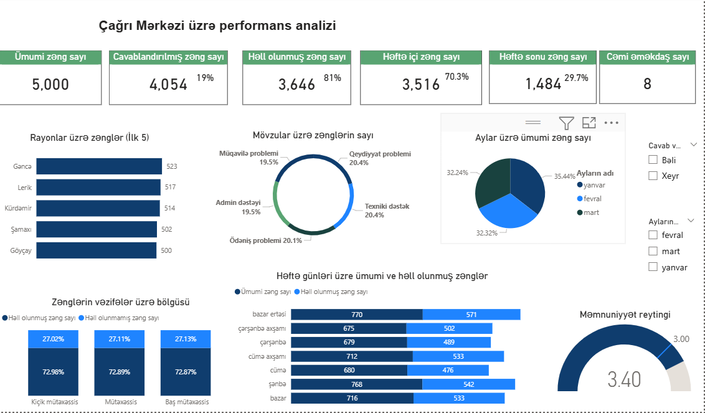
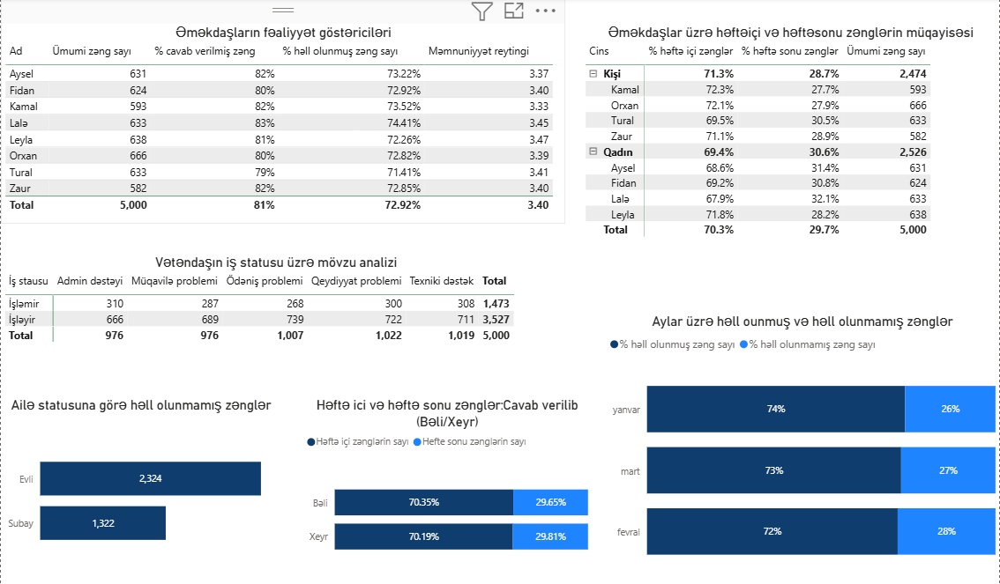

# Call Center Performance Analysis
## Project Overview
This project analyzes call center performance using Power BI, focusing on employee productivity, call resolution, and customer satisfaction.
## Dashboard 1: Overview

## Dashboard 2: Employee Performance

## Tools Used
- Power BI
- DAX
- Data Visualization
- Data Analysis

